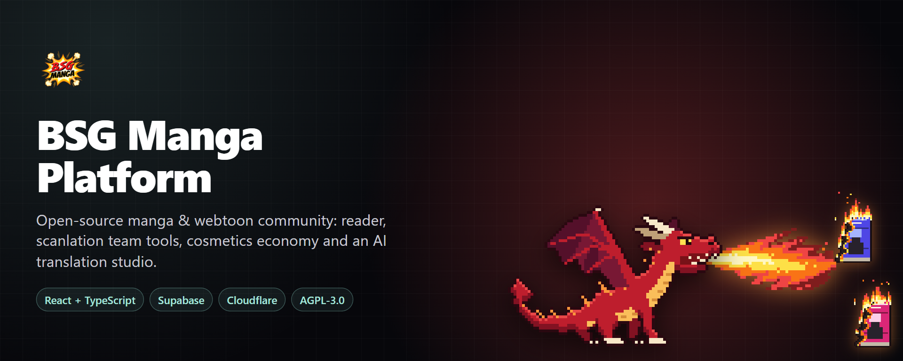
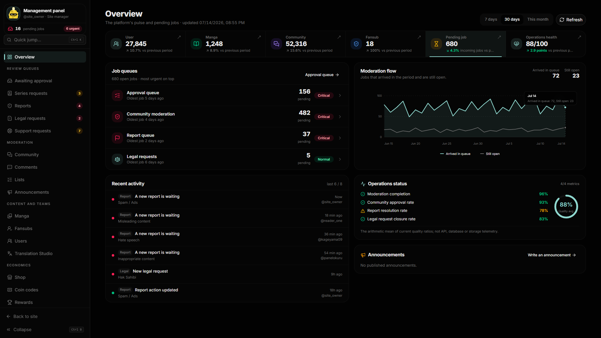
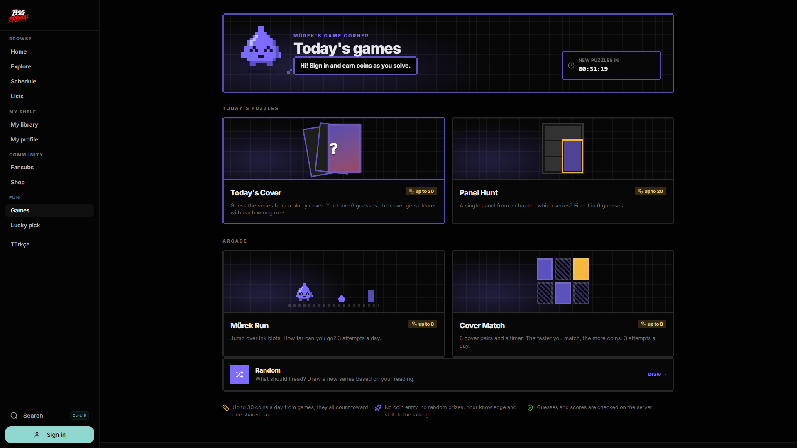
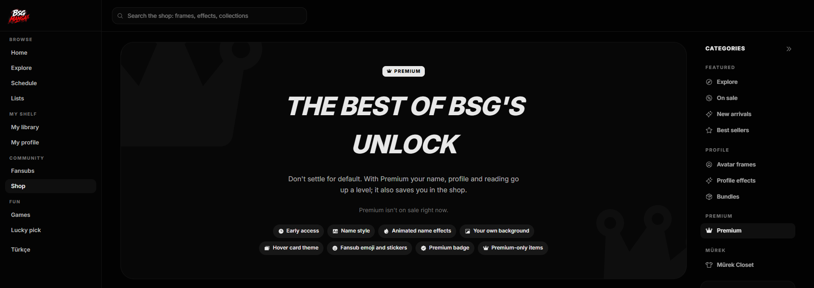
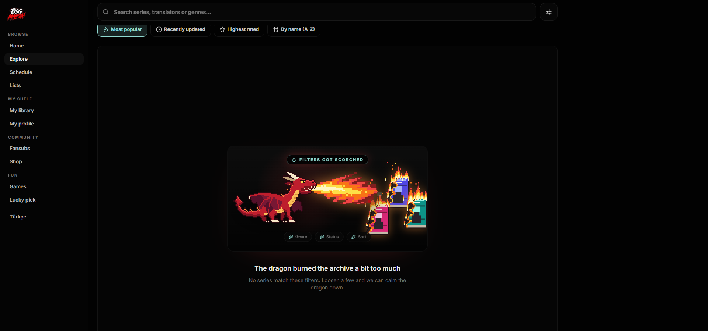
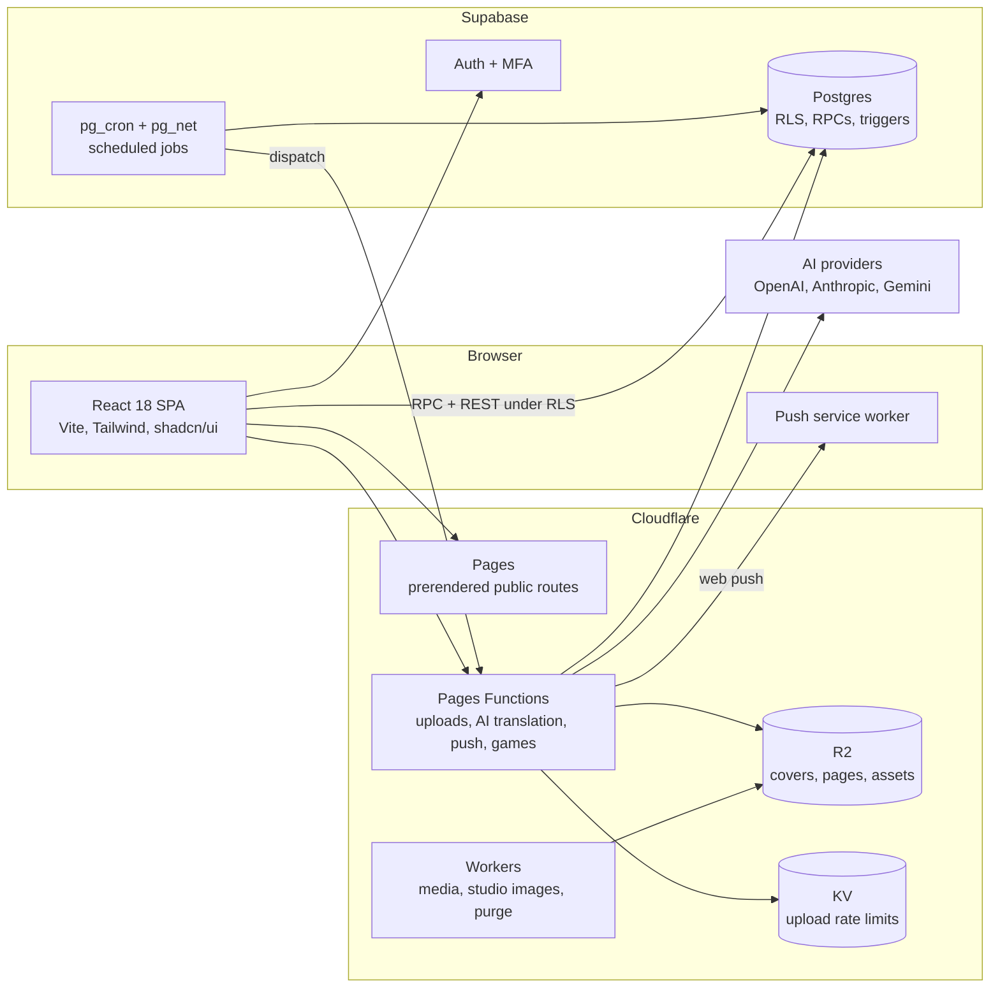

<div align="center">



# BSG Manga Platform

**A complete, self-hostable manga and webtoon community: reader, scanlation team tools, a cosmetics economy, mini-games and an AI translation studio.**

[](https://github.com/Yasin-solak/bsg-manga-platform/actions/workflows/ci.yml)
[](LICENSE)
[](COMMERCIAL-LICENSE.md)


[Features](#features) · [Screenshots](#screenshots) · [Architecture](#architecture) · [Self-hosting](#self-hosting) · [Engineering](#engineering-practices) · [Contributing](#contributing) · [License](#license)

</div>

---

## What is this?

Most manga site projects stop at "list series, show pages". BSG Manga goes much further. It models the whole community around reading: the teams who translate, the readers who support them, the coin economy and shop, the moderators who keep it clean, and the admins who run it.

It was built and run as a real product for about a year, then opened up. That history shows: there is a full moderation workflow, a legal request desk, security event monitoring and hundreds of guard tests, not just the happy path.

> [!IMPORTANT]
> **No content is included.** This repository contains software only. Publish only works you hold the rights to or have permission to distribute. See [Content and legal](#content-and-legal).

### At a glance

| | |
|---|---|
| **Code** | ~235,000 lines of TypeScript in 1,449 files |
| **Database** | 508 Postgres migrations, 600+ row level security policy statements |
| **Tests** | 291 contract test files and 34 Playwright end-to-end specs |
| **Languages** | Full English and Turkish UI, about 10,000 translated strings, localized URLs and hreflang |
| **Hosting** | Supabase and Cloudflare, no servers of your own to manage |

## Screenshots

> Screenshots use mock data from the test suite. No real users are shown.

<table>
<tr>
<td width="50%"><br /><sub><b>Admin overview.</b> Queues ranked by urgency, moderation flow and operations health.</sub></td>
<td width="50%"><br /><sub><b>Mini-games.</b> Daily puzzles and arcade games that reward coins, hosted by the mascot Mürek.</sub></td>
</tr>
<tr>
<td width="50%"><br /><sub><b>Shop and Premium.</b> Perks can each be switched on or off from the admin panel.</sub></td>
<td width="50%"><br /><sub><b>Details matter.</b> Even "no results" gets a dragon.</sub></td>
</tr>
</table>

## Features

### Reading
- Vertical and paged reader with progress tracking, keyboard shortcuts and image preloading
- Library, reading history, public lists, ratings and comments with spoiler handling
- Explore page with curated shelves, recommendations and a release schedule
- A yearly "Wrapped" summary with reader personas
- Age gating enforced at the database level: adult series are never returned to unverified users

### Scanlation teams (fansubs)
- Public team pages with a showcase scene, tabs, roster, announcements and release calendar
- Team studio: members, roles and permissions, chapter upload and review, task assignment, statistics
- **Boost system:** readers give teams power, and levels unlock visible perks. Expiry and notifications are automatic
- Donations, a supporter wall, and team-specific emoji and stickers
- Chapter credit rails that show who translated what at the end of each chapter

### AI translation studio
- A guided pipeline: upload pages → detect text with OCR → translate with AI → typeset → publish
- Pluggable providers (OpenAI, Anthropic, Gemini) with a daily spending cap
- Readers can also request translations of a page into their own language
- Off by default, and it needs your own API key. Provider usage costs are yours

### Profiles and cosmetics
- Profile showcase with selectable modules, and themes built from color, scene style and pattern
- Avatar frames and profile effects with intro and loop animations
- Name styles: fonts, colors, fills and animated effects
- **Mürek**, the mascot: a closet, colors, accessories and cousins

### Economy and shop
- Coin wallet with a transaction ledger and server-side purchase logic
- Storefront with seasons, campaigns, bundles, gifting, wishlists and discount rules
- Premium membership, redeem codes, quests, levels, badges and reading streaks

### Games and events
- Daily puzzles (Today's Cover, Panel Hunt), arcade games (Mürek Run, Cover Match) and a lucky pick
- Limited-time site events, such as characters that appear on the site to catch, with leaderboards and automatic reward payout

### Community
- Discord-style community servers with channels, roles, invites, attachments and moderation
- Notification center and standards-based web push (RFC 8291) with per-type preferences
- Mentions, reactions, follows, blocks and private accounts

### Administration
- A desk-style admin panel for approvals, reports, legal requests, support, users, teams, series, shop, rewards, games and diagnostics
- **Feature flags:** nearly every system can be turned on or off without a deploy
- Security events, alert rules, bans, an audit feed and maintenance mode
- Text translation desk: admins can translate database-driven text from the panel

### Security and privacy
- Row level security across the schema, with sensitive writes going through `SECURITY DEFINER` functions
- Email and social sign-in, MFA, session management and leaked password checks
- Rate-limited uploads, content validation and a private bucket for community files
- Privacy and KVKK data rights pages, plus DMCA and legal request workflows

## Architecture



**Why this shape?** The browser talks directly to Postgres, so authorization has to live in the database. Business rules such as purchases, rewards and moderation are SQL functions, not client code. Anything that needs a secret or heavy work runs in Cloudflare Functions, and object storage stays cheap on R2.

| Layer | Technology |
|---|---|
| Interface | React 18, TypeScript, Vite, Tailwind CSS 4, shadcn/ui, Framer Motion |
| Routing and i18n | React Router 7, localized URLs, gettext-style dictionaries, per-route prerendering |
| Data | Supabase Postgres, RLS, RPCs, triggers, `pg_cron`, Zod validation at the client boundary |
| Server | Cloudflare Pages Functions and Workers |
| Storage | Cloudflare R2 and KV |
| Testing | Contract tests (Node), Playwright, custom audit scripts |

### Repository layout

```text
src/
  pages/        Route-level screens (reader, shop, profile, admin, studio...)
  components/   Shared and feature UI
  services/     Data access and business calls to Supabase and Functions
  i18n/         Locale routing and the English dictionary
functions/api/  Cloudflare Pages Functions (uploads, translation, push, games)
workers/        Cloudflare Workers (community media, studio images, purge)
supabase/
  migrations/   Complete schema history
  seed-assets/  Shop images for a fresh install
tests/
  contracts/    Fast guard tests, part of CI
  e2e/          Playwright browser tests
scripts/        Build, audit, seed and deployment tooling
```

## Self-hosting

### Prerequisites
- Node.js 20 or newer
- A [Supabase](https://supabase.com) project with the `pg_cron` and `pg_net` extensions enabled
- A public file host for images. [Cloudflare R2](https://www.cloudflare.com/developer-platform/r2/) is recommended
- Optional for production: [Cloudflare Pages](https://pages.cloudflare.com)

### 1. Install

```bash
git clone https://github.com/Yasin-solak/bsg-manga-platform.git
cd bsg-manga-platform
npm ci
cp .env.example .env
```

### 2. Set up the database

```bash
npx supabase link --project-ref <your-project-ref>
npx supabase db push
```

The migrations install the schema, security rules, server functions and scheduled jobs. The full chain is checked on an empty database in CI (the `migrations` workflow). A few contain placeholders you should replace with your own addresses before pushing:

```bash
grep -rln "example.com\|your-project-ref" supabase/migrations
```

#### Local database (optional)

With [Docker](https://www.docker.com/products/docker-desktop/) running you can start a local Supabase instead. It applies every migration to an empty database:

```bash
npx supabase start
```

Then point `.env` at the local API it prints (`http://127.0.0.1:54321` and its anon key).

### 3. Upload the shop images

Shop images live in `supabase/seed-assets/store-assets/`, using the same paths they need in your bucket. Upload them and set `VITE_STORE_ASSET_PUBLIC_BASE_URL`.

```bash
cd supabase/seed-assets/store-assets
find . -type f | sed 's|^\./||' | while read f; do
  npx wrangler r2 object put "store-assets/$f" --file="$f" --remote
done
```

### 4. Configure

Fill in at least these values in `.env`:

| Variable | Purpose |
|---|---|
| `VITE_SUPABASE_URL` | Supabase project URL |
| `VITE_SUPABASE_ANON_KEY` | Supabase public key |
| `VITE_STORE_ASSET_PUBLIC_BASE_URL` | Public URL for shop images |
| `VITE_CHAPTER_PAGE_PUBLIC_BASE_URL` | Public URL for chapter pages |

> [!CAUTION]
> Server secrets such as `SUPABASE_SERVICE_ROLE_KEY` and AI provider keys must never use the `VITE_` prefix or be committed. `VITE_` values are shipped to every browser.

### 5. Run

```bash
npm run dev
```

Create your first account, then make it an admin from the Supabase SQL editor:

```sql
update public.users set role = 'admin' where username = '<your-username>';
```

The admin panel's **Operations** section controls which systems are on: community, translation studio, boosts and more.

### 6. Deploy (optional)

Set your KV IDs and bucket names in `wrangler.toml`, change the project name in `package.json`, then run:

```bash
npm run deploy:cf
```

### Known limitations

- The project was developed against a live database for about a year. The full migration chain is now checked on an empty database in CI, but a setup that differs from the defaults (other Postgres versions, missing extensions) may still hit something. Please open an issue if it does.
- Some systems are off by default, including community sharing and the translation studio.
- User-facing strings are written as Turkish source keys and translated through `src/i18n/messages/en/`. Generated audit reports in `docs/reports/` are still in Turkish.
- Legal page templates were written for a Turkish operator. Have them reviewed for your own jurisdiction.

## Engineering practices

This is the part worth reading if you are here to learn from the code.

**Contract tests as guardrails.** `tests/contracts` holds 291 fast tests that pin behavior and intent: database policies, RPC signatures, routing rules, UI invariants. They run the real source where they can. When a component is redesigned, its contract is updated to protect the new intent rather than deleted.

**Quality gates.** Every pull request must pass all of these:

```bash
npm run lint              # ESLint, including architecture rules
npm run lint:text         # Encoding and text checks
npm run build             # Type check, build and prerender
npm run test:contracts    # Contract tests
npm run health:repo:strict  # File size and repo health against a baseline
npm run audit:deep:strict   # Deep audits against a baseline
```

**Baselined audits.** Scripts measure API resilience, complexity, schema serialization, session state and multi-tenant safety. They compare against committed baselines, so debt cannot grow silently.

**Translation that survives refactors.** Text is wrapped with `txa('...')`, and a contract test fails when a literal has no dictionary entry. Database-driven text is translated at render time. CSS never selects on visible text, because that would break when the language changes.

**Language-aware routing.** English lives at the root (`/explore`) and Turkish under `/tr` (`/tr/kesfet`). App code uses one canonical path, and a lint rule forces all links through the locale-aware router.

## Roadmap

- [x] Verify the migration chain on a clean database
- [x] Move source comments and tests to English
- [x] Docker-based local database
- [ ] Publish a one-command demo seed
- [ ] Make adding a third language a documented, dictionary-only change

Ideas are welcome in [issues](../../issues).

## Contributing

Contributions are welcome. Start with [CONTRIBUTING.md](CONTRIBUTING.md). Please report security problems privately, following [SECURITY.md](SECURITY.md), and follow the [Code of Conduct](CODE_OF_CONDUCT.md).

## Content and legal

BSG Manga is software. It includes no manga, webtoons or other copyrighted reading content, and it is not affiliated with any publisher. **If you run an instance, you are responsible for what it hosts.** The platform includes copyright notice and takedown tooling, but using it does not by itself make any content legal to publish.

## License

BSG Manga Platform is licensed under the **[GNU Affero General Public License v3.0](LICENSE)**.

- You may use, modify and distribute the code.
- If you run a modified version as a service, you must offer its source code to its users under the same license.

**Commercial license:** to use the code in a closed-source product without AGPL obligations, see [COMMERCIAL-LICENSE.md](COMMERCIAL-LICENSE.md).

The "BSG Manga" name, logo and the Mürek character belong to the project owner. Please use a different name and logo in forks.

<div align="center">
<br />
<sub>If this project is useful or interesting to you, a star helps others find it.</sub>
</div>
